# Kết quả thực nghiệm

Cấu hình chung: YOLOv8n (3,0 M tham số), khởi tạo từ trọng số COCO, 80 epoch, ảnh 640, batch 32,
SGD + cosine LR, `fliplr=0` (không lật ngang vì biển có hướng), `seed=0`, GPU RTX 5060 8 GB.
Số liệu chi tiết: `docs/results/*.csv`.

## 1. Mô hình triển khai: 7 lớp (`tsr7`)

Dữ liệu: ảnh VN thật + 647 ảnh GTSRB dán lên nền VN (chỉ ở tập train), xem `dataset.md`. Train 80 epoch, 56 phút.

**Tập test VN thật** (713 ảnh, 228 biển):

| Mô hình | P | R | mAP50 | mAP50-95 | GH40 | GH50 | GH60 | Cấm ngược chiều | Cấm rẽ trái | Cấm rẽ phải | Vòng xuyến |
|---|---|---|---|---|---|---|---|---|---|---|---|
| `best.pt` (640) | 0,978 | 0,946 | **0,961** | 0,742 | 0,990 | 0,770 | 0,994 | 0,986 | 0,995 | 0,995 | 0,995 |
| `tsr_416_int8.onnx` | 0,940 | 0,878 | 0,906 | 0,658 | 0,887 | 0,781 | 0,838 | 0,901 | 0,995 | 0,943 | 0,995 |

**Tập `test_gtsrb`** (271 ảnh, crop GTSRB *Test* dán lên ảnh test VN; chỉ có GH50, GH60, cấm ngược chiều, vòng xuyến):
`best.pt` mAP50 0,989; `tsr_416_int8.onnx` 0,968.

**Nhận xét**

- 5/7 lớp đạt AP50 ≥ 0,99. Lớp yếu nhất là **GioiHan50** (0,77): tập test chỉ có 16 biển, phần lớn rất nhỏ/ở xa;
  ma trận nhầm lẫn cho thấy lỗi chủ yếu là bỏ sót (nhầm với nền), **không** nhầm sang 40/60.
- Không có nhầm lẫn giữa cấm rẽ trái và cấm rẽ phải — nhờ tắt lật ngang (`fliplr=0`) khi tăng cường dữ liệu.
- Tập test các lớp Vòng xuyến (9), Cấm rẽ trái (21) nhỏ → kết quả từng lớp còn bất định; cần kiểm chứng bằng video tự quay.

## 2. Đánh đổi tốc độ – độ chính xác khi triển khai (mô hình 7 lớp)

Tập test VN thật. Thời gian suy luận đo bằng ONNX Runtime 1.31, 4 luồng CPU **trên PC** (i5-13400F, không phải Pi), chỉ để so sánh tương đối.

| Mô hình | Input | Kiểu số | Dung lượng | P | R | mAP50 | mAP50-95 | CPU PC (ms) |
|---|---|---|---|---|---|---|---|---|
| `tsr_640.onnx` | 640 | FP32 | 12,8 MB | 0,980 | 0,944 | **0,963** | **0,745** | 24,3 |
| `tsr_640_int8.onnx` | 640 | INT8 | 6,2 MB | 0,982 | 0,932 | 0,963 | 0,740 | 20,7 |
| `tsr_416.onnx` | 416 | FP32 | 12,7 MB | 0,938 | 0,880 | 0,904 | 0,664 | 11,3 |
| **`tsr_416_int8.onnx`** | 416 | INT8 | 6,1 MB | 0,940 | 0,878 | **0,906** | 0,658 | **9,5** |
| `tsr_320.onnx` | 320 | FP32 | 12,7 MB | 0,937 | 0,767 | 0,820 | 0,572 | 7,0 |
| `tsr_320_int8.onnx` | 320 | INT8 | 6,1 MB | 0,927 | 0,764 | 0,809 | 0,561 | 6,1 |

**Lượng tử hoá INT8 – ảnh hưởng của việc giữ Detect head ở FP32** (416):

| Cách lượng tử hoá | mAP50 | CPU PC (ms) | Dung lượng |
|---|---|---|---|
| FP32 (không lượng tử hoá) | 0,904 | 11,3 | 12,7 MB |
| INT8 toàn bộ, chỉ giữ phần giải mã box FP32 | 0,734 | 7,5 | 3,5 MB |
| INT8, hiệu chỉnh Percentile 99,99 | 0,872 | 7,7 | 3,5 MB |
| **INT8 backbone + neck, giữ cả Detect head FP32** (đang dùng) | **0,906** | 9,5 | 6,1 MB |

Đầu phân loại của head rất nhạy với lượng tử hoá (AP cấm ngược chiều tụt 0,92 → 0,45), nên giữ head ở FP32:
mất một phần tốc độ nhưng không mất độ chính xác.

**Khuyến nghị cho Raspberry Pi:** `tsr_416_int8.onnx`. Nếu Pi 5 còn dư tốc độ: `tsr_640_int8.onnx` (mAP50 0,963).
Số lớp (5 hay 7) gần như không ảnh hưởng tốc độ: chỉ thay đổi vài kênh ở lớp cuối (YOLOv8n 5 lớp và 7 lớp đều ≈ 8,2 GFLOPs; kích thước input và INT8 mới là yếu tố quyết định).

## 3. Nghiên cứu nguồn dữ liệu (bộ 5 lớp, thí nghiệm trước khi chốt 7 lớp)

Bộ 5 lớp ban đầu: GioiHan60, VongXuyen, DuongCam, CamDiNguocChieu, Stop. Dữ liệu chi tiết: `results/pt_data*.csv`, `results/onnx_vn_test.csv`.


**Tập test VN thật** (713 ảnh, 135 biển thuộc 4 lớp; không có "Đường cấm"):

| Mô hình | Dữ liệu train | P | R | mAP50 | mAP50-95 | AP50 GH60 | AP50 Vòng xuyến | AP50 Cấm ngược chiều | AP50 Stop |
|---|---|---|---|---|---|---|---|---|---|
| Phiên bản cũ (input 128) | GTSRB | 0,245 | 0,229 | 0,229 | 0,198 | 0,000 | 0,003 | 0,000 | 0,915 |
| C | chỉ GTSRB (tổng hợp) | 0,110 | 0,158 | 0,059 | 0,038 | 0,002 | 0,049 | 0,102 | 0,085 |
| A | chỉ VN | 0,960 | 0,974 | **0,992** | **0,783** | 0,994 | 0,995 | 0,984 | 0,995 |
| **B** | **VN + GTSRB** | **0,977** | 0,970 | 0,990 | 0,774 | 0,984 | 0,995 | 0,987 | 0,995 |

**Tập `test_gtsrb`** (354 ảnh: crop GTSRB *Test* dán lên ảnh test VN, đủ 5 lớp):

| Mô hình | mAP50 | mAP50-95 | AP50 Đường cấm |
|---|---|---|---|
| Phiên bản cũ (input 128) | 0,000 | 0,000 | 0,000 |
| C – chỉ GTSRB | **0,994** | **0,964** | 0,995 |
| A – chỉ VN | 0,275 | 0,200 | 0,000 |
| **B – VN + GTSRB** | 0,987 | 0,951 | 0,984 |

**Nhận xét**

1. **Chênh lệch miền dữ liệu (domain gap) rất lớn.** Mô hình chỉ học GTSRB (C) gần như hoàn hảo trên biển
   kiểu Đức nhưng chỉ đạt mAP50 = 0,06 trên ảnh đường phố VN. Ngược lại, mô hình chỉ học VN (A) chỉ đạt 0,28
   trên biển GTSRB. Điều này giải thích vì sao hệ thống cũ hoạt động khi giơ biển trước webcam nhưng
   không phù hợp với đường thật: dùng GTSRB "làm nền tảng" là chưa đủ, bắt buộc phải có dữ liệu Việt Nam.
2. **Kết hợp hai nguồn (B) giữ được cả hai**: trên ảnh VN tương đương A (0,990 so với 0,992 — chênh lệch nằm
   trong sai số do tập test nhỏ), đồng thời nhận được lớp "Đường cấm" (không có trong dữ liệu VN) và biển
   kiểu GTSRB. → Cách kết hợp này được dùng cho mô hình 7 lớp.
3. Mô hình cũ với input 128 không phát hiện được biển nhỏ trong cảnh rộng (biển 34 px chỉ còn ~7 px);
   nó chỉ nhận tốt Stop vì các ảnh Stop trong tập test phần lớn là biển cỡ lớn, chụp gần.

**Lưu ý về độ tin cậy:** mAP50 ≈ 0,99 trên tập test VN cao hơn nhiều công bố khác. Nguyên nhân có thể là tập test
có ít mẫu (Vòng xuyến: 9, Stop: 12) và ảnh trong bộ dữ liệu có thể được trích từ cùng đoạn video với ảnh train
(dù đã loại các ảnh gần trùng ở mức dHash). Cần kiểm chứng thêm bằng video tự quay trên đường ở Thái Nguyên.


Khi quét video đường phố thật, các biển Stop và Đường cấm gần như không xuất hiện ở Việt Nam, còn các phát hiện "Stop"/"Đường cấm"
đều là biển hiệu cửa hàng màu đỏ → nhóm chuyển sang bộ 7 lớp bám sát phạm vi thuyết minh (giới hạn tốc độ, biển cấm, vòng xuyến).

## 4. Đường cong huấn luyện và ma trận nhầm lẫn

Mô hình 7 lớp: 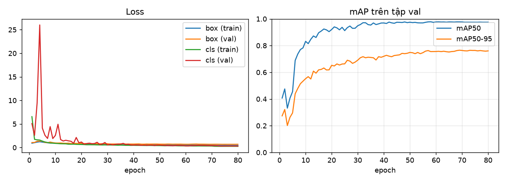

Ma trận nhầm lẫn (chuẩn hoá, tập val): 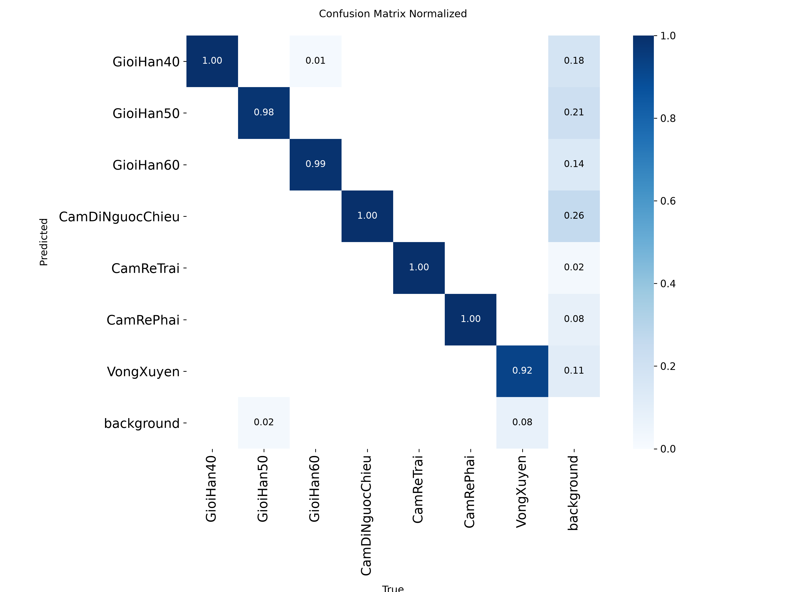

Ví dụ dự đoán trên tập val: 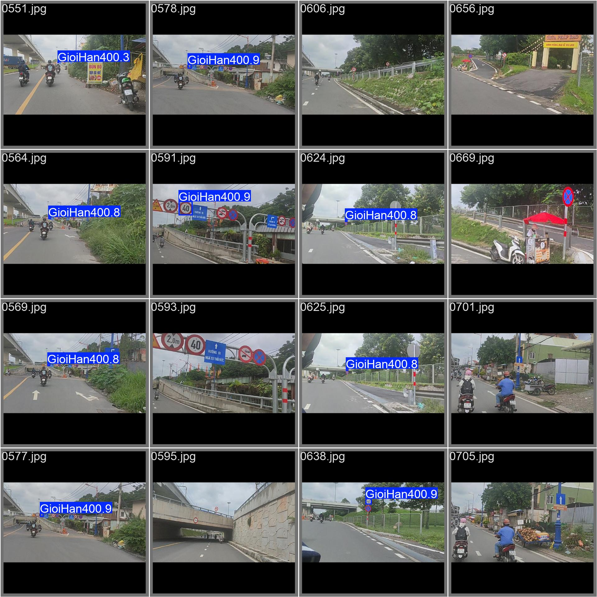

Bộ 5 lớp:

| A – chỉ VN | B – VN + GTSRB | C – chỉ GTSRB |
|---|---|---|
| 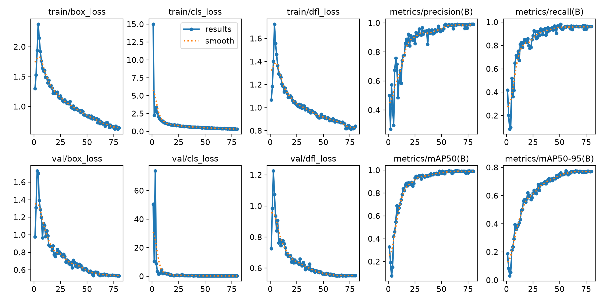 | 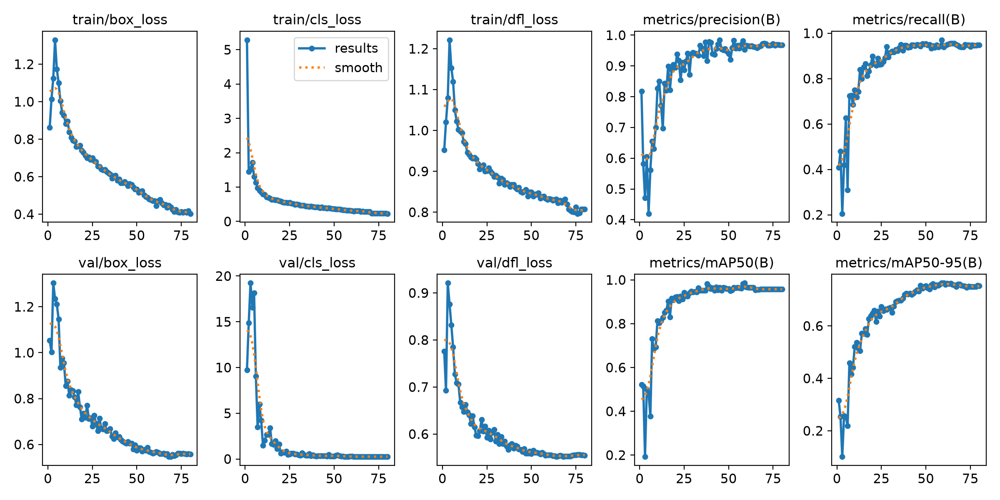 | 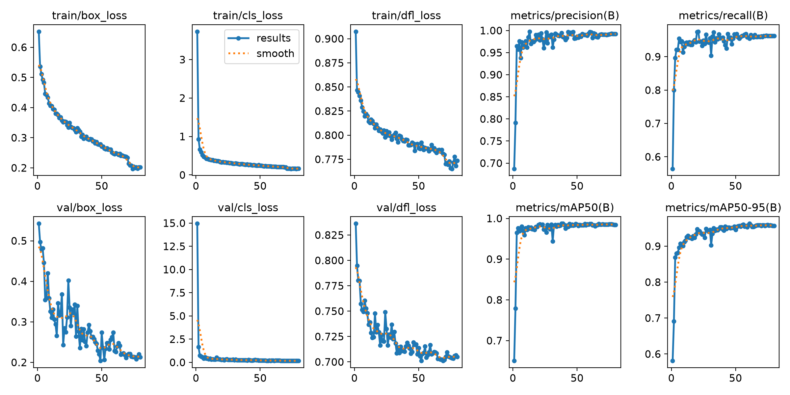 |

Ma trận nhầm lẫn (chuẩn hoá) của mô hình B trên tập val: 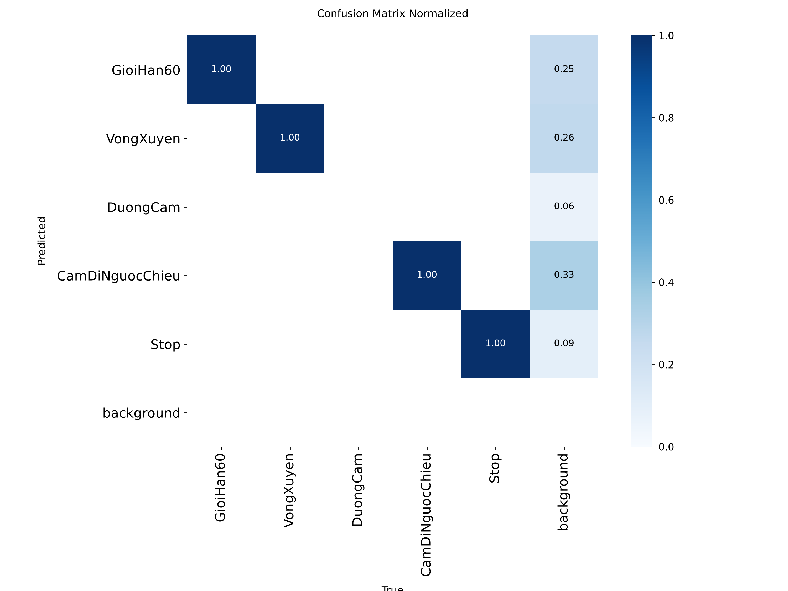

Ví dụ dự đoán trên tập val: 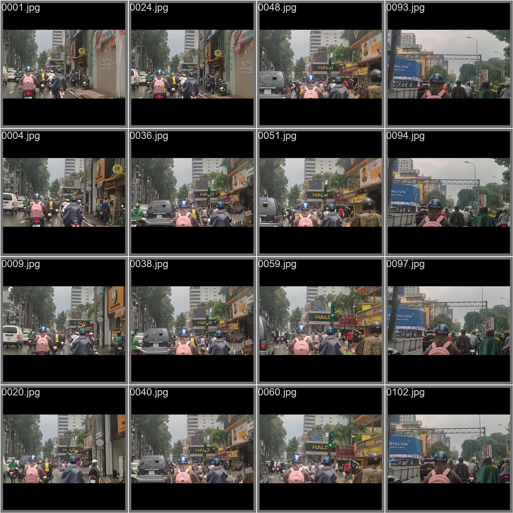

## 5. Thử trên video đường phố

Hai video lái xe máy trong nội thành Hà Nội (kênh YouTube "Vietnam Silent Routes", CC BY, 720p, ~115 phút),
độc lập với dữ liệu huấn luyện. `tools/scan_video.py`: 1/5 khung hình, ngưỡng 0,5, gộp các phát hiện cùng lớp cách nhau
≤ 2 s (≥ 3 lần) thành một sự kiện. Từng sự kiện được kiểm tra bằng mắt.

| Lớp dự đoán | Sự kiện | Đúng | Sai | Báo sai chủ yếu |
|---|---|---|---|---|
| CamDiNguocChieu | 90 | 85 | 5 | biển hiệu, hình in màu đỏ |
| CamReTrai | 4 | 4 | 0 | |
| VongXuyen | 18 | 3 | 15 | logo Hà Nội tròn xanh, biển xanh tròn khác |
| GioiHan40/50/60 | 21 | 0 | 21 | biển hạn chế chiều cao (3,3 m; 4,75 m), biển hiệu |
| **Tổng** | **133** | **92** | **41** | độ chính xác theo sự kiện 69% |

| Đúng | Đúng | Sai (hạn chế chiều cao → GioiHan50) |
|---|---|---|
| 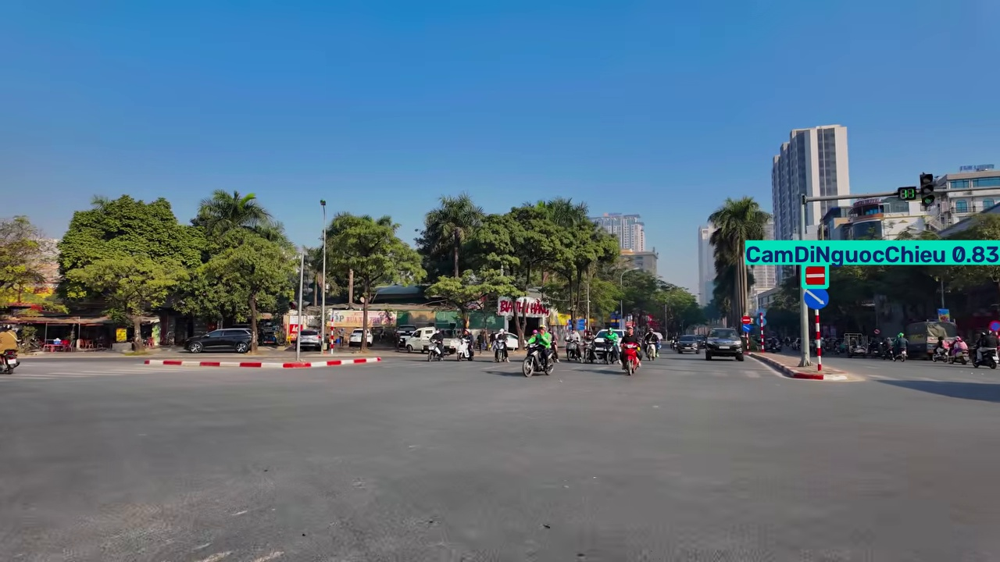 | 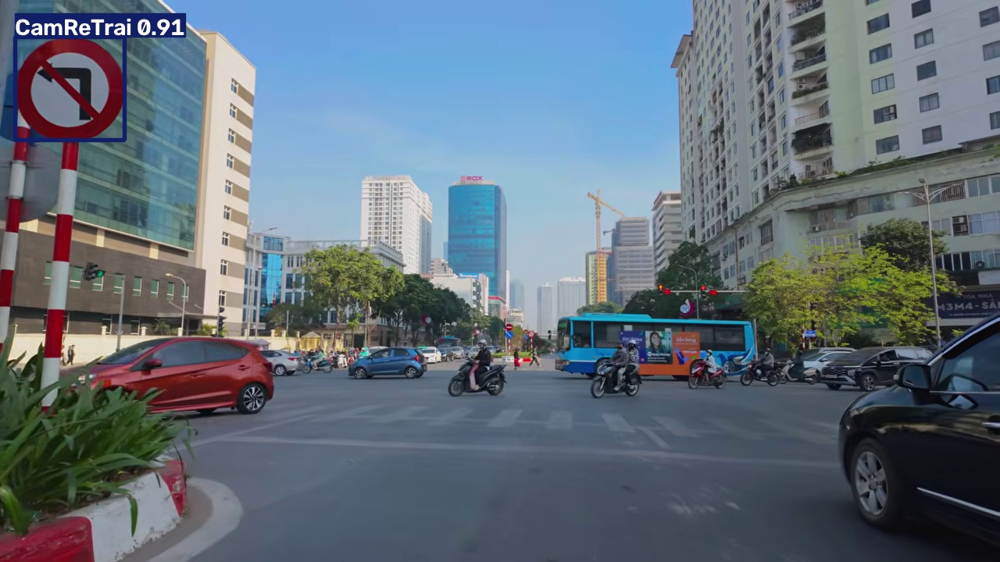 | 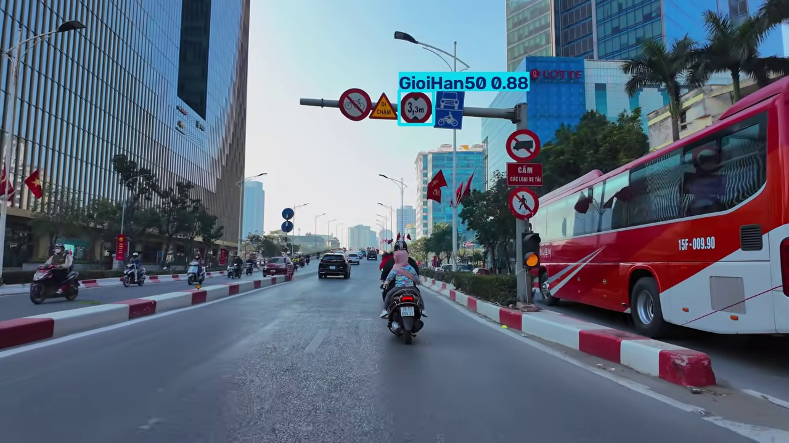 |

- Cấm đi ngược chiều (dày đặc nhất trong nội thành) đúng 94%, ổn định qua nhiều khung.
- Hai video không có biển giới hạn tốc độ nhưng nhiều biển **hạn chế chiều cao** (viền đỏ, nền trắng, chữ số) → mô hình nhầm
  hết thành giới hạn tốc độ. Vòng xuyến bị nhầm với **logo Hà Nội** trên cột đèn. Tập test ảnh tĩnh (mAP50 0,96) không phản ánh
  được lỗi này vì thiếu các mẫu âm tương ứng.
- Việc cần làm: thêm mẫu âm (biển hạn chế chiều cao, logo, khung báo sai từ video — *hard negative mining*) rồi train lại;
  ngưỡng riêng cho lớp giới hạn tốc độ/vòng xuyến; bộ lọc K/N khung trên thiết bị loại các phát hiện thoáng qua.

## 6. Đo trên Raspberry Pi (cần bổ sung)

Điền sau khi chạy trên thiết bị thật (lệnh: `docs/deploy_raspberry_pi.md` §6):

| Thiết bị | Mô hình | Python (ms / FPS) | C++ (ms / FPS) | FPS toàn hệ thống (camera + hiển thị) | Nhiệt độ CPU |
|---|---|---|---|---|---|
| Pi 4 / Pi 5 | `tsr_416_int8.onnx` | | | | |
| Pi 4 / Pi 5 | `tsr_416.onnx` | | | | |
| Pi 4 / Pi 5 | `baseline_v1_128.onnx` (cũ) | | | | |

## 7. Tái tạo

```bash
python training/train.py --data datasets/tsr7/data.yaml --model yolov8n.pt --name v8n_tsr7
python training/export.py --weights runs/v8n_tsr7/weights/best.pt --imgsz 320 416 640 --int8 \
    --calib datasets/tsr7/train/images --out models
python training/evaluate.py --data datasets/tsr7/data.yaml --split test \
    --models models/tsr_416.onnx models/tsr_416_int8.onnx --out docs/results/tsr7_vn_test.csv
```
